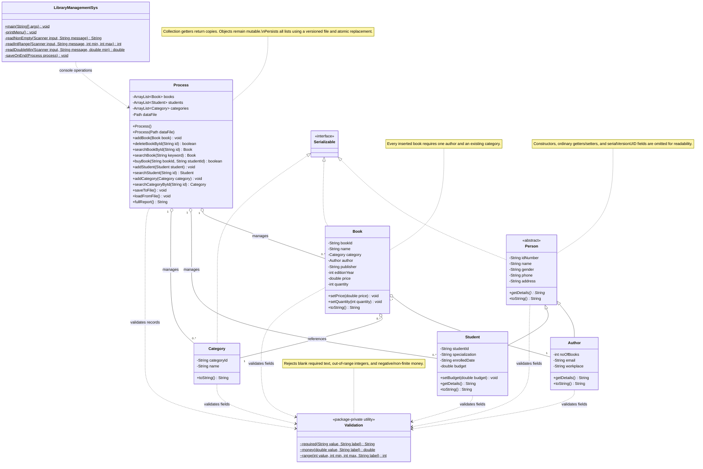

# Library Management System

A Java console application by Ragad Mohammed Eid for managing books, students, categories, and simulated book purchases.

## Features

- Add, list, search, and delete books.
- Add and list students; search student records through the application API.
- Purchase by exact book ID, checking stock and student budget.
- Show a report of books, students, and categories.
- Save and restore local data with Java serialization.
- Validate required fields, finite non-negative prices and budgets, stock, and unique IDs.

## Requirements and running

Install JDK 17 or newer (both `java` and `javac` must be on PATH). No external libraries are required.

On Windows, open PowerShell in the project folder:

```powershell
./run.ps1
```

Alternatively, compile and run from the project root:

```sh
javac --release 17 -encoding UTF-8 -d build/classes src/librarymanagementsys/*.java
java -cp build/classes librarymanagementsys.LibraryManagementSys
```

In NetBeans, open this folder as an existing Java Ant project and select JDK 17 or newer. Source and target levels are 17.

The application creates five initial categories for a new library. Add a student and a book before trying a purchase. Choose `9` to save and exit. End-of-input also attempts a save. Other changes stay in memory until saving; force-closing the process may lose unsaved changes.

## Tests

```powershell
./test.ps1
```

The standalone suite covers exact-ID purchases, stock and budget checks, duplicate IDs, invalid values, list isolation, persistence, corrupt-file handling, save failures, legacy category recovery, and decimal subtraction. Tests use temporary files rather than real library data.

## Data storage

`lib_data.dat` is a local file relative to the working directory. It is excluded from Git. Saving writes a temporary file and uses atomic replacement; if this is unsupported or fails, the application reports failure and preserves the existing file. Loading validates all records before replacing in-memory lists. Invalid data stops startup to avoid overwriting it.

Older files containing only books and students can be loaded when compatible; categories are recovered from books. Back up old data before migration. Invalid or duplicate legacy records are rejected instead of silently deleted. Deserialization includes type and resource limits; use local data from trusted sources.

## Structure

`Person` is an abstract base for `Author` and `Student`. `Book` references an `Author` and a `Category`. `Process` manages operations and persistence; `LibraryManagementSys` provides the console menu; `Validation` supplies common checks.

## Scope

This is a local educational inventory and purchase simulation. It does not provide real payments, borrowing/returns, user authentication, a database server, or multi-user access. Phone, email, and enrollment date fields are required text, not verified contacts or dates. Money uses finite doubles with decimal subtraction; a production financial system should use a consistent decimal money model. Objects returned by getters remain mutable, while returned lists are copies; state is validated again before save.

Use fictional records for demonstrations. Do not commit local identity, contact, or student records. The release excludes compiled files, NetBeans private settings, the original data file, and the original assignment document.

## UML class diagram

The diagram matches the corrected source. Aggregation denotes references, not exclusive ownership. Ordinary getters/setters, constructors, and serialVersionUID fields are omitted for readability.



Editable source: [class-diagram.mmd](docs/class-diagram.mmd).
